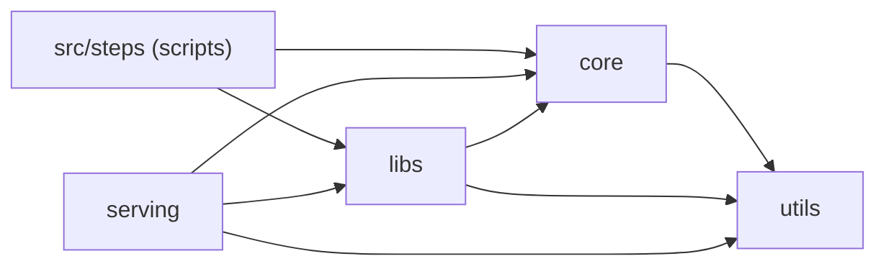
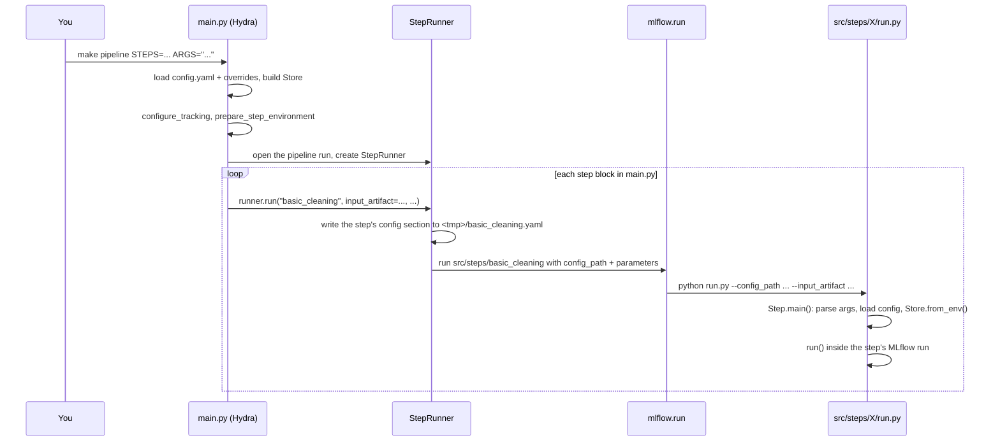

# Architecture

How this project is organized, how a pipeline run flows through the code, and what each package, helper and library is for. The [README](../README.md) has the commands; this guide explains what's behind them.

## Contents

1. [The big picture](#the-big-picture)
2. [Project layout and layers](#project-layout-and-layers)
3. [How a pipeline run works](#how-a-pipeline-run-works)
4. [Configuration](#configuration)
5. [Package reference](#package-reference)
6. [Libraries](#libraries)
7. [Where code runs](#where-code-runs)
8. [Recipes](#recipes)
9. [Testing](#testing)
10. [Conventions and gotchas](#conventions-and-gotchas)

## The big picture

-   **The pipeline** is a list of **steps**. Each step is an MLflow project in `src/steps/<step>` whose `run.py` subclasses `core.step.Step`. `main.py` runs them in order, one MLflow run per step, nested under one pipeline run.
-   **Configuration** lives in `config.yaml`, loaded by Hydra. Each step has a section there, and the step receives it as `self.config`.
-   **Data and artifacts** are read and written through the **store** (`core.store.Store`), by location and name (`store.load_data("raw", "listings.csv")`). Files are always local; with `store.sync_s3` on, the store also downloads missing files from S3 and uploads what it saves.
-   **Models** subclass `core.model.CustomModel`, are saved through the store (`models/` by default) and logged to MLflow.
-   **Serving** (`src/serving`) is a FastAPI app that loads a saved model through the store and predicts with it.
-   **Experiment tracking** is MLflow: a tracking server backed by PostgreSQL (`make run`), or a local SQLite file (`launcher.local=true`).
-   **Environments** come from `uv.lock`: your `.venv` has everything, and the Docker images and step environments only get the dependency set they need.

## Project layout and layers

```
src/
  core/        Abstractions the rest builds on
    store/       Store, RemoteStorage (S3Storage), DataEngine (PandasEngine, DaskEngine)
    step.py      Step: base class of every pipeline step
    model.py     CustomModel: base class of custom MLflow models
  libs/        Building blocks a step or main.py chooses to use
    pipeline.py  StepRunner: runs the steps from main.py
    tracking.py  MLflow setup: tracking URI, runs, step environments, model registry
    data/        transforms.py (config-driven DataFrame transforms), eda.py (reports)
  utils/       Small generic helpers with no project knowledge
    config.py    Loading and writing config files
    log.py       Logging setup
    files.py     Atomic file and folder replacement
    serialization.py
  steps/       The pipeline steps, one MLflow project per folder (not a package)
  serving/     The FastAPI app
templates/step Cookiecutter template used by `make step`
tests/         Mirrors src/ (tests/core, tests/libs, tests/serving, tests/utils)
docs/          This guide
main.py        Runs the pipeline (Hydra entry point)
run.py         Runs main.py as an MLflow project
MLProject      The root MLflow project used by run.py
config.yaml    All configuration
pyproject.toml Dependencies and tool settings; uv.lock has the exact versions
Dockerfile     pipeline, serving and test images
Makefile       The main commands; includes makefiles/
makefiles/     The other targets by area (dev, mlflow, infra, docker, clean) and common.mk
```

### Layers



| Package | Contains | Decide by asking | May import |
|---|---|---|---|
| `core` | Abstractions other code subclasses or implements, plus the machinery that works through them | "Will other code extend this?" | `utils` |
| `libs` | Building blocks tied to a specific tool (MLflow, pandas transforms, EDA libraries) | "Is this an integration or a reusable piece a step opts into?" | `core`, `utils` |
| `utils` | Generic helpers that would make sense in any Python project | "Does this know nothing about the project?" | nothing internal |
| `serving` | The API | | `libs`, `core`, `utils` |
| `steps` | Pipeline steps (scripts run by MLflow) | | everything; nothing imports a step |

`make lint` enforces the arrows with import-linter (`[tool.importlinter]` in `pyproject.toml`): an import against them fails the check.

`core`, `libs`, `utils` and `serving` are installed packages (`[tool.hatch.build.targets.wheel]`), so `from core.store import Store` works from anywhere: `main.py`, a step, a notebook, a test or a container. Nothing depends on `PYTHONPATH`.

## How a pipeline run works



1.  **`make pipeline`** runs `python main.py "main.steps='all'" <ARGS>` through `uv run`. `makefiles/common.mk` exports `.env` and `PROJECT_ROOT`.
2.  **`main.py`** gets the config from Hydra (`config.yaml` plus command-line overrides such as `store.sync_s3=true`) and:
    -   makes `root` absolute (`utils.config.with_absolute_root`);
    -   sets the tracking URI (`libs.tracking.configure_tracking`): local SQLite with `launcher.local=true`, otherwise `MLFLOW_TRACKING_URI`;
    -   builds the `Store` from the `store` section;
    -   prepares the step environment (`libs.tracking.prepare_step_environment`);
    -   opens the pipeline run (`libs.tracking.managed_run`) and creates a `StepRunner`.
3.  **One block per step** calls `runner.run(step, **parameters)`. The runner:
    -   writes the step's whole config section, `${...}` resolved, to a temporary YAML file;
    -   calls `mlflow.run(src/steps/<step>, parameters={"config_path": ..., **parameters}, run_name=step)`;
    -   has already exported `STORE_CONFIG` (the resolved store config) and `PIPELINE_RUN_ID` (the pipeline run), which every step process inherits.
4.  **MLflow** creates the step's run and starts the command in the step's `MLproject`: `python run.py --config_path ... --input_artifact ...`.
5.  **`Step.main()`** in the step's `run.py`:
    -   parses `--config_path` plus the step's own parameters (`add_arguments`);
    -   loads `self.config` from `config_path` (or the step's section of `config.yaml` when run on its own);
    -   builds `self.store` with `Store.from_env()` (reads `STORE_CONFIG`) and `self.logger`;
    -   continues the step's MLflow run, tags its parent, logs `step_config.yaml`, and calls `run()`.
6.  **`run()`** reads and writes through `self.store`. An exception fails the step's run, `mlflow.run` raises in `main.py`, and the pipeline stops.

`run.py` is the alternative entry point: it runs the root `MLProject`, whose command is `python main.py ...`, so the whole pipeline is itself one MLflow project run (with its own environment from `python_env.yaml` when `launcher.env_manager` is `uv` or `virtualenv`).

## Configuration

### config.yaml

| Section | What it controls |
|---|---|
| `root` | The project folder: `${oc.env:PROJECT_ROOT,.}`. `make` exports `PROJECT_ROOT`; otherwise a relative root is resolved from the folder of `config.yaml`. Other paths build on it with `${root}`. |
| `main` | `project_name` and `experiment_name` (the MLflow experiment is `<project_name>_<experiment_name>`), and `steps` (`all` or a comma-separated subset of `_steps` in `main.py`). |
| `launcher` | `local`: SQLite tracking (`mlflow.db`) and steps in the current environment. `env_manager`: where steps run when `local` is false (`local`, `uv`, `virtualenv`). `run_name`: the pipeline run's name (default `<project>_pipeline`). |
| `store` | `local_root`, `sync_s3`, default `bucket` and `prefix`, AWS settings, and `locations` (see [Store](#corestore)). |
| `<step name>` | One section per step: everything the step needs, nested values included. `main.py` passes the values it picks as MLflow parameters; the step sees the whole section as `self.config`. |

`${...}` is OmegaConf interpolation, resolved every time the config is loaded: `${basic_cleaning.output_artifact}` chains one step's output to the next one's input, and `${oc.env:AWS_BUCKET,null}` reads an environment variable with a default.

### Where values come from

1.  `config.yaml`;
2.  overrides on the command line: `make pipeline ARGS="store.sync_s3=true launcher.local=true"` (Hydra syntax; `+key=value` adds a key that doesn't exist);
3.  environment variables read through `${oc.env:...}`: `.env` (or `.env.beta` / `.env.prod` with `ENV=beta|prod`), exported by `makefiles/common.mk`. `example.env` documents every variable.

Steps never read `config.yaml` directly when launched by `main.py`: they get their resolved section (`config_path`) and the resolved store config (`STORE_CONFIG`), so overrides reach them.

## Package reference

### core.store

`Store` reads and writes files by **location** and **name**:

```python
from core.store import Store

store = Store.from_env()   # in steps, notebooks and serving
```

| Method | Does |
|---|---|
| `load_data(location, name, engine="pandas", columns=None, dtypes=None, parse_dates=None, format=None, **read_options)` | Reads a DataFrame. Format from the extension (`.csv`, `.parquet`/`.pq`, `.json`, `.jsonl`) or `format=`. `columns`, `dtypes` and `parse_dates` behave the same for every format; other options go to the reader. With `engine="dask"`, `name` can be a folder or a glob (`events/*.parquet`). |
| `save_data(location, name, df, format=None, sync=True, **write_options)` | Writes a DataFrame with the engine that owns its type (pandas or dask). Returns the local path. |
| `load_artifact(location, name, reader=None)` | Makes sure the file or folder is local and returns `reader(path)`, or the path. |
| `save_artifact(location, name, writer, sync=True)` | Calls `writer(path)` to create a file or folder (a report, a plot, a model) and moves it into place. Returns the local path. |
| `path(location, name="")` | The local path. No transfer: anything written there by hand stays local. |
| `uri(location, name="")` | The remote URI (`s3://...`), or `None` without a bucket. |
| `from_config(config, base_dir=None, **kwargs)` | Builds a store from a `store` section (dict or OmegaConf). |
| `from_env(**kwargs)` | `$STORE_CONFIG` when launched by `main.py`, otherwise the project's `config.yaml`. |
| `to_dict()` / `dump(path)` | The resolved config, as a dict or a YAML file (what `STORE_CONFIG` points to). |

Behavior:

-   **Paths:** `<location path>/<name>`. A relative location path is relative to `local_root`; an absolute one (e.g. `${root}/models`) can be anywhere.
-   **S3 keys:** `s3://<location bucket or store.bucket>/<location prefix or store.prefix/<location name>>/<name>`.
-   **Sync (`store.sync_s3: true`):** a load whose file is missing locally downloads it first (a file, a folder, or the files matching a glob); a save uploads afterwards, unless `sync=False`. A local file always wins over S3. With sync off, S3 is never contacted.
-   **Atomic writes:** writers work on a temporary sibling (`.tmp-<id>-<name>`, extension kept) that replaces the target only when complete; a failed write leaves the previous version.
-   **Folder mirroring:** a folder upload deletes remote files that no longer exist locally, so a re-saved dask dataset with fewer parts has no stale ones.
-   **Validation when the store is created:** unknown keys in a location, an empty `locations`, a bucket containing a path, or `sync_s3` with a location that has no bucket all fail immediately.

Extension points:

| Interface | Built in | Implement | Use |
|---|---|---|---|
| `RemoteStorage` (`remote.py`) | `S3Storage` (boto3; any S3-compatible endpoint with `endpoint_url`) | `exists`, `list_keys`, `get_file`, `put_file`, `delete_keys`; folder downloads, mirroring and atomic downloads come from the base class | `Store(..., remote=MyStorage())` |
| `DataEngine` (`engines.py`) | `PandasEngine`, `DaskEngine` | `owns(df)`, `read(...)`, `write(...)` | `Store(..., engines={"polars": PolarsEngine()})`, then `engine="polars"` |

`Location` is the resolved form of one location (`name`, `path`, `bucket`, `prefix`, `key(name)`). `STORE_CONFIG_ENV` is the name of the environment variable `main.py` sets.

### core.step

`Step` is the base class of every pipeline step:

| Member | Purpose |
|---|---|
| `run(self)` | Abstract: the step's work. |
| `add_arguments(cls, parser)` | Declare the step's parameters (the same as in its `MLproject`). `--config_path` is added for every step. |
| `main(cls, argv=None)` | Entry point of `run.py` (see [the run flow](#how-a-pipeline-run-works)). |
| `name` | The step's name; defaults to its folder (`step_name()`), which is also its config section. |
| `self.args`, `self.config`, `self.store`, `self.logger` | Available in `run()`. `self.config` is an OmegaConf `DictConfig` (`self.config.min_price` or `self.config["min_price"]`). |

`PIPELINE_RUN_ENV` (`PIPELINE_RUN_ID`) carries the pipeline run's ID to the steps, which tag it as their parent.

### core.model

`CustomModel` extends `mlflow.pyfunc.PythonModel`. Subclass it and implement `predict(self, context, model_input, params=None)`.

-   `save(store, name, sample, location="models", code_paths=None, log_model=True, params=None, sync=True)` infers the signature by predicting on `sample` (also stored as the input example), logs the model to the active MLflow run (`log_model`) and saves it through the store to `<location>/<name>`. Returns the `ModelInfo`, or `None` without logging.
-   `CustomModel.load(store, name, location="models")` loads any pyfunc model saved there, downloading it first when missing and sync is on.

### libs.pipeline

`StepRunner(steps_path, config, store, work_dir, env_manager, parent_run_id=None)` is created by `main.py` inside the pipeline run. `run(step, run_name=None, **parameters)` runs `src/steps/<step>` with its config section (`config_path`) and `parameters`, names the step's MLflow run (`run_name` or the step's name) and returns the submitted run. A step whose folder doesn't exist yet is skipped with a warning, so the default blocks in `main.py` work before the steps are created.

### libs.tracking

| Function | Does |
|---|---|
| `configure_tracking(root_path, is_local)` | Local: removes the `MLFLOW_TRACKING_*` variables and tracks to `<root>/mlflow.db`. Otherwise: loads `.env` and uses `MLFLOW_TRACKING_URI`. Returns the tracking URI. |
| `prepare_step_environment(root_path, env_manager)` | Sets `PROJECT_ROOT`. `local`: puts the current interpreter first on `PATH`, so steps use `.venv`. `uv` / `virtualenv`: keeps the step environments in `.mlflow-envs/<hash of uv.lock>` and applies `uv.lock` as constraints, so steps get the same versions as `.venv`. |
| `managed_run(experiment_name, run_name=None)` | Context manager: sets the experiment and starts a run, continuing the one MLflow passed (`MLFLOW_RUN_ID`) when `run.py` launched `main.py`, or reusing an active run. |
| `register_model(run_id, model_name)` | Registers `runs:/<run_id>/<model_name>` in the MLflow model registry. |

### libs.data

`transforms.py` holds config-driven pandas transforms. Each takes a DataFrame and a config section with this shape:

| Function | Config keys |
|---|---|
| `apply_filters(data, config)` | `filters: [{column, value}]` keeps rows where `column == value`; `exclude_suffixes: [...]` drops columns ending with them. Both keys are required (use `[]`). |
| `apply_aggregations(data, config)` | `groupby: [...]`, `aggregations: [{column, name, aggfunc}]`, optional `date_columns: [...]` (grouped by date) and `custom_functions: [{name, condition, true_value, false_value}]` usable as `aggfunc` (true_value when any value equals `condition`). |
| `generate_custom_features(data, config)` | `custom_features: [{operation, name, ...}]` with `subtract` (`columns`), `divide` (`columns`, optional `fillna`; 0 when dividing by 0), `fillna` (`value`), `diff` (`column`, `fillna`), `rolling_mean` (`column`, `window`). |
| `generate_date_features(data, config)` | `date_columns: [first is parsed]`, `date_features: [{operation, name, column}]` with `dayofweek`, `is_weekend` (on a dayofweek column), `month`, `quarter`, `year`. |
| `convert_to_date(data, columns)` | Parses the columns as dates. |

`eda.py` holds exploration helpers: `log_dataset(data, path, name, context)` (logs an MLflow dataset input), `describe_data(data, name)` (logs `describe()` as a JSON artifact), `generate_eda_report(data, title, output_path)` (ydata-profiling HTML) and `generate_heatmap(data, output_path)` (correlation heatmap). The report and plot functions write to a path, so use them as store writers:

```python
store.save_artifact("analytics", "eda/report.html",
                    writer=lambda path: generate_eda_report(df, "EDA", path))
```

### utils

| Helper | Does |
|---|---|
| `config.load_config(path)` | Reads a YAML file into a dict. |
| `config.serialize_config(config, output_path)` | Writes a dict or OmegaConf node to YAML with `${...}` resolved; returns the absolute path. |
| `config.find_project_config(start=None)` | Finds `config.yaml` from `$PROJECT_ROOT` or the current folder upwards (works from a step's folder). |
| `config.load_project_config(path=None)` | Loads it with `root` made absolute. |
| `config.with_absolute_root(config, base)` | Makes a relative `root` absolute from `base`. |
| `config.load_step_config(step, config_path=None)` | A step's config: the file, or its resolved section of `config.yaml`. |
| `log.get_logger(name)` | A logger; configures logging once per process (`[time] [LEVEL][name] message` to stdout). |
| `files.tmp_sibling(path)`, `files.replace_path(src, dst)`, `files.remove_path(path)` | The atomic-write building blocks the store uses. |
| `serialization.convert_timestamps(obj)` | Converts dates in a nested dict to ISO strings (for JSON). |

### serving

| Module | Contains |
|---|---|
| `app.py` | `create_app(settings=None, store=None)` builds the app; `app` is the instance uvicorn runs (`serving.app:app`). At startup it loads the model, and a configured model that can't be loaded stops the startup. |
| `settings.py` | `Settings` from the environment: `SERVING_MODEL_NAME`, `SERVING_MODEL_LOCATION` (default `models`), plus the title and version shown in the docs. |
| `model.py` | `ModelService`: loads the model with `CustomModel.load`, describes its signature and predicts. Whole numbers sent for float columns are converted before predicting, and outputs are converted to plain JSON values. |
| `routes.py` | `GET /health`, `GET /ready`, `GET /model`, `POST /predict`, with `get_model` / `get_loaded_model` dependencies (503 without a model). |
| `schemas.py` | Pydantic request and response models; their descriptions and examples document the API at `/docs` and `/redoc`. |

## Libraries

| Library | Used for | Where |
|---|---|---|
| [uv](https://docs.astral.sh/uv/) | Environments, locking (`uv.lock`) and running commands | Makefile, Dockerfile, step environments |
| [Hydra](https://hydra.cc/) / [OmegaConf](https://omegaconf.readthedocs.io/) | Loading `config.yaml`, command-line overrides, `${...}` interpolation | `main.py`, `run.py`; OmegaConf everywhere config is read |
| [MLflow](https://mlflow.org/) | Tracking runs, running steps as projects, saving and loading models, the model registry | `libs.tracking`, `libs.pipeline`, `core.step`, `core.model` |
| PostgreSQL | MLflow's backend store for the tracking server | `docker-compose.yml`, `make mlflow-server` |
| pandas, pyarrow | DataFrames and Parquet | the store's pandas engine, `libs.data` |
| [dask](https://docs.dask.org/) | Larger-than-memory DataFrames | the store's dask engine (`pipeline` extra) |
| boto3 | S3 | `core.store.remote.S3Storage` |
| scikit-learn, statsmodels | Modeling | your steps |
| [FastAPI](https://fastapi.tiangolo.com/), uvicorn, pydantic | The API, its server and its validation and docs | `src/serving` (`serving` extra) |
| ydata-profiling, seaborn, matplotlib | EDA reports and plots | `libs.data.eda`, notebooks (`eda` group) |
| pytest, moto, httpx | Tests; moto fakes S3, httpx powers FastAPI's TestClient | `tests/` (`test` group) |
| ruff | Linting and formatting | `make lint`, `make format`, pre-commit |
| [import-linter](https://import-linter.readthedocs.io/) | Enforcing the package layers | `make lint` |
| pre-commit | ruff on every commit | `make hooks` |
| cookiecutter | Generating steps from `templates/step` | `make step` |
| Docker, Docker Compose | PostgreSQL, the local S3 server, the project's images | `docker-compose.yml`, `Dockerfile` |

## Where code runs

| Where | Python environment | Tracking | Started by |
|---|---|---|---|
| Your machine | `.venv` (every extra and group) | server (`MLFLOW_TRACKING_URI`) or SQLite (`launcher.local=true`) | `make pipeline`, `make serve`, notebooks |
| Step, `env_manager=local` | the same `.venv` | the pipeline's | `main.py` |
| Step, `env_manager=uv` / `virtualenv` | one environment per step from its `requirements.txt` (the project with the `pipeline` extra, versions from `uv.lock`) | the pipeline's | `main.py` |
| Pipeline image | base + `pipeline` | `http://host.docker.internal:5000` by default | `make docker-pipeline` |
| Serving image | base + `serving` | none needed | `make docker-serve` |
| Test image | base + every extra + `test` | SQLite in temporary folders | `make docker-test` |

## Recipes

**Add a step**

1.  `make step` and answer the prompts. Parameters are the values you'll pass from `main.py` (typically `input_artifact,output_artifact`); everything else goes in the config section.
2.  Paste the block the hook prints into `main.py` (and add the name to `_steps`), and the section into `config.yaml`.
3.  Implement `run()`: read with `self.store.load_data(...)`, use `self.config`, save with `self.store.save_data(...)` or `save_artifact(...)`.
4.  Try it alone with `uv run mlflow run src/steps/<step> --env-manager local -P ...`, then in the pipeline with `make pipeline STEPS=<step>`.

**Add a data location**: add it under `store.locations` (`path`, and `bucket` / `prefix` when it syncs somewhere other than the defaults). Steps use it by name.

**Turn on S3**: set `AWS_BUCKET` (and a profile or keys) in `.env`, then `make pipeline ARGS="store.sync_s3=true"`, or set `sync_s3: true` in `config.yaml`. To try it without AWS, use the local S3 server (README > Local S3).

**Train and serve a model**: in a step, subclass `CustomModel` and call `model.save(self.store, "price_model", sample=X.head())`; then `SERVING_MODEL_NAME=price_model make serve` and open http://localhost:8000/docs.

**Add an API endpoint**: add a route to `src/serving/routes.py` with its request and response models in `schemas.py`; use the `LoadedModel` dependency when it needs the model. Test it with `TestClient(create_app(Settings(...), store))`.

**Add a dependency**: `uv add <package>` for base, `uv add --optional pipeline|serving <package>` for one image, `uv add --group dev|test|notebook|eda <package>` for development only.

**Add a storage backend or DataFrame engine**: subclass `RemoteStorage` or `DataEngine` (see [core.store](#corestore)) and pass it to the store; `Store.from_env(remote=..., engines=...)` in steps.

**Add a make target**: everyday commands go in the `Makefile`; anything else in the matching `makefiles/<area>.mk`, or a new file added to the `include` line at the end of the `Makefile`. Variables from `makefiles/common.mk` (`$(UV_RUN)`, `$(PYTHON)`, the `.env` values) are available everywhere. Add `##@<Group> description` after the target to list it in `make help`, and the target to that file's `.PHONY`.

**Run everything in Docker**: `make run` (MLflow server on your machine), then `make docker-pipeline`, `make docker-serve SERVING_MODEL_NAME=...` or `make docker-test`.

## Testing

-   `tests/` mirrors `src/`; `make test` runs it with pytest (`make docker-test` in the test image).
-   Stores in tests point at `tmp_path` folders; S3 is faked with moto (`tests/core/test_store.py`), and a fake in-memory backend and engine show the extension points (`tests/core/test_store_extensions.py`).
-   MLflow tests use a SQLite tracking URI in `tmp_path` and restore the previous one afterwards.
-   `tests/libs/test_pipeline.py` runs a real step through `mlflow.run`, and `tests/serving` uses FastAPI's `TestClient` with `create_app(Settings(...), store)`.

## Conventions and gotchas

-   **Names:** a step's folder, its config section and its name in `main.py` are the same snake_case name. `make step` rejects anything else.
-   **`config_path` is reserved:** every step gets it; don't use it as one of your parameters.
-   **Data stays out of git and images:** `data/` and `models/` are gitignored and excluded from Docker builds; containers mount them. S3 (with sync on) is the shared copy.
-   **A local file wins:** with sync on, the store downloads only what's missing locally. Delete the local copy to get the S3 version again.
-   **`store.path()` doesn't sync:** use `save_artifact` when the result must reach S3.
-   **macOS port 5000:** the AirPlay Receiver listens on port 5000. Turn it off (System Settings > General > AirDrop & Handoff) or set `MLFLOW_TRACKING_SERVER_PORT` and `MLFLOW_TRACKING_URI` to another port in `.env`.
-   **MLflow allowed hosts:** the MLflow server rejects requests addressed to host names it doesn't know. `MLFLOW_ALLOWED_HOSTS` in `.env` lists localhost and `host.docker.internal`; add the host name clients use if the server runs elsewhere.
-   **Empty `AWS_PROFILE`:** boto3 treats `AWS_PROFILE=` as a profile named "" and fails. Comment the line out instead of leaving it empty.
-   **Projects keep their own step template:** `templates/step` is copied when the project is generated; update it there.
